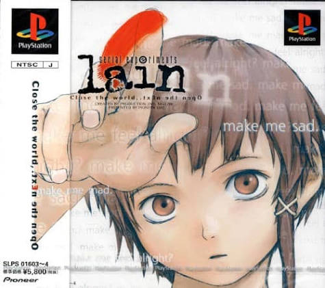
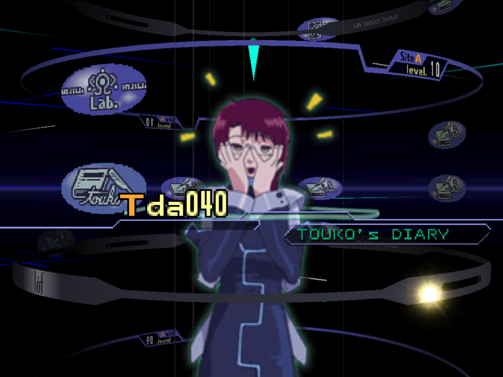
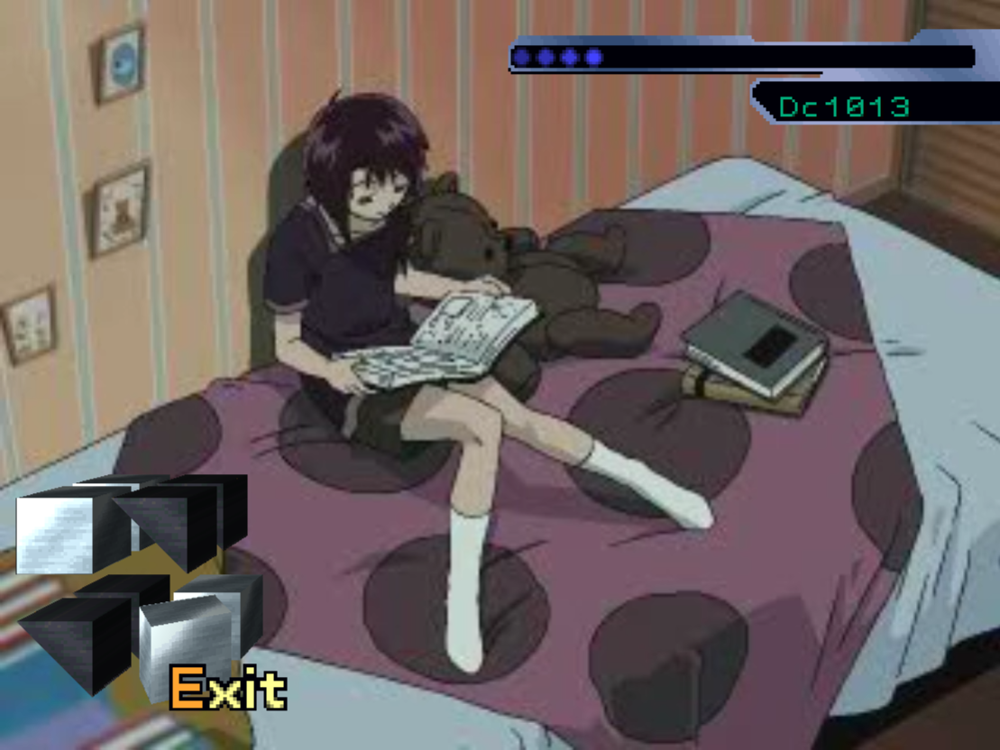
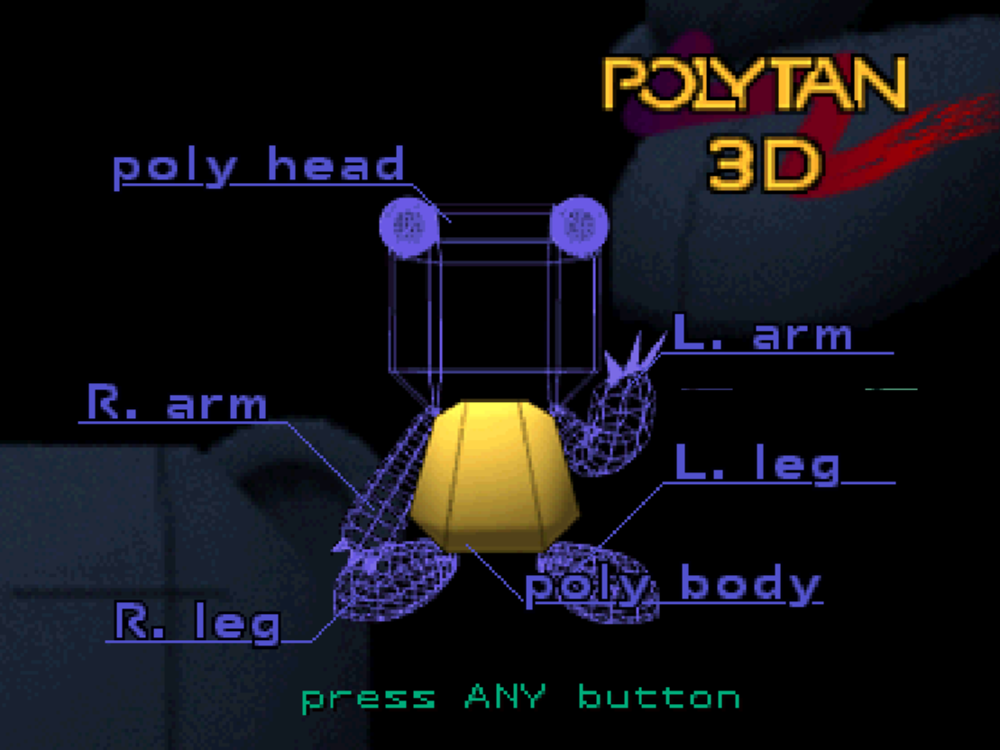
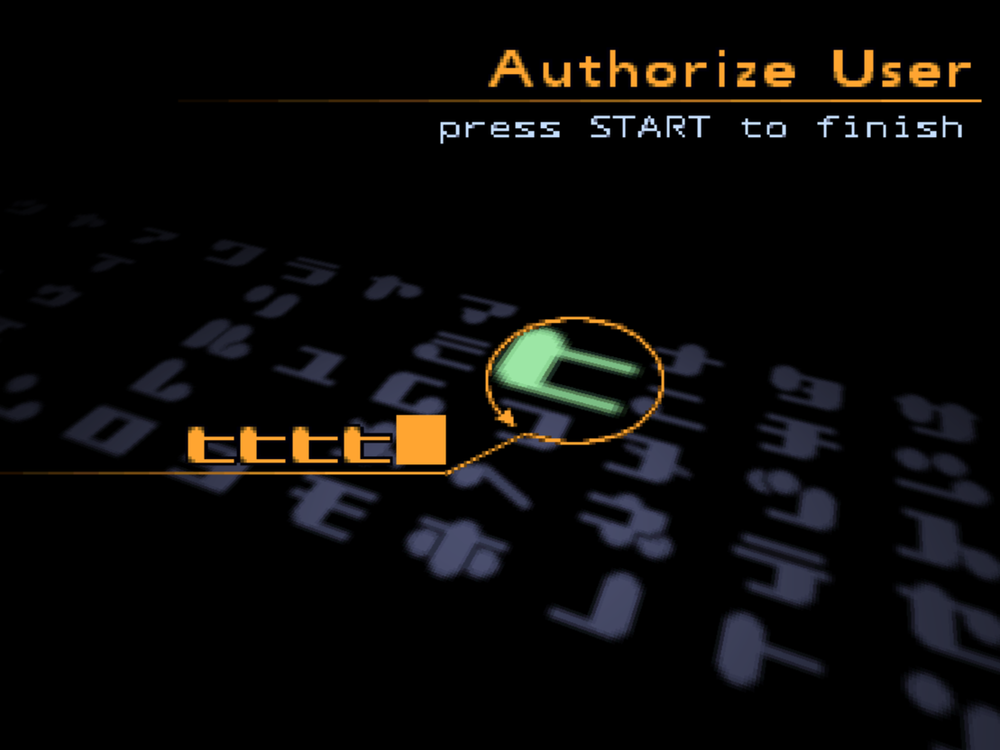
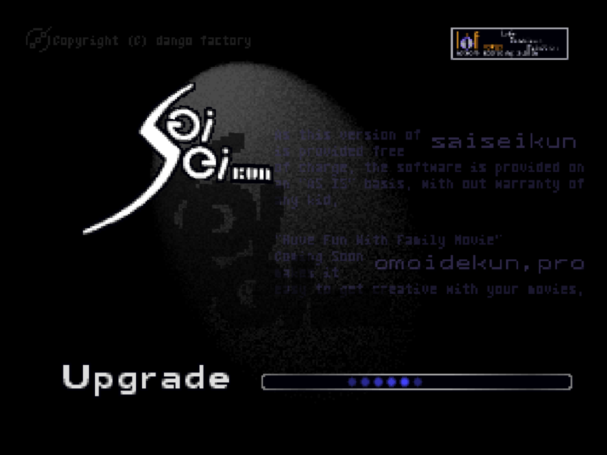
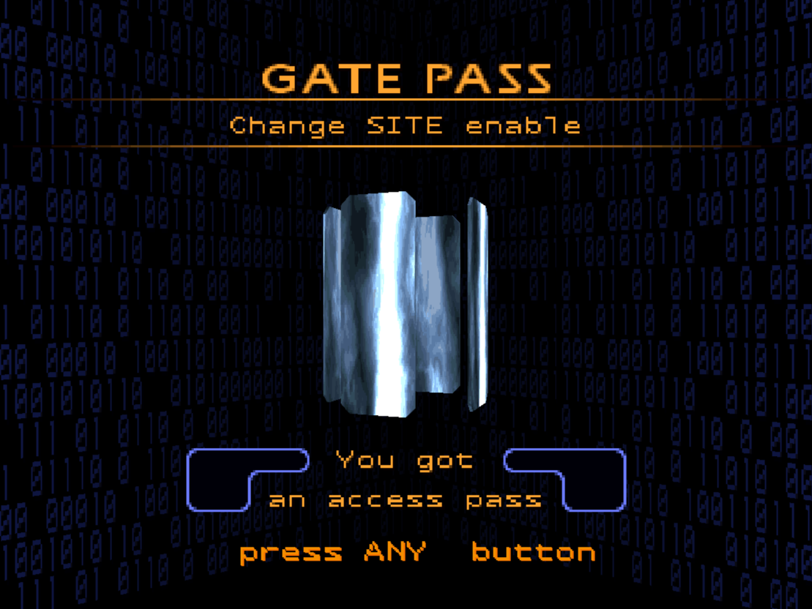
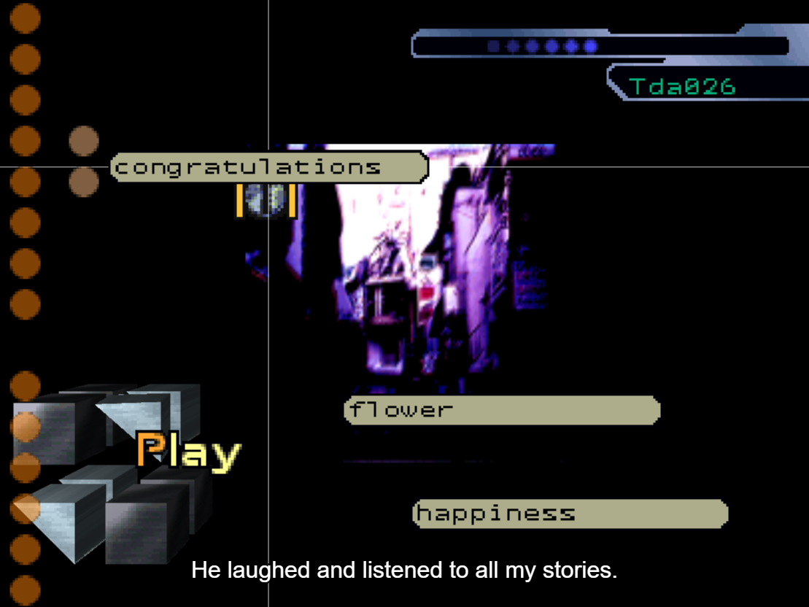
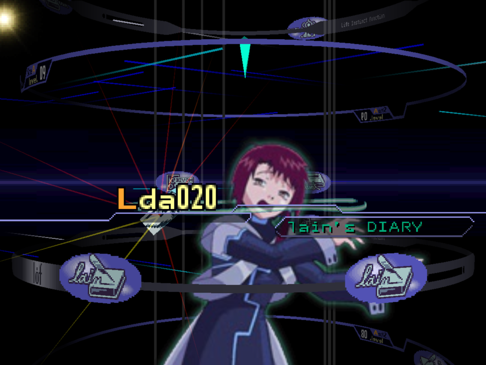

<div align="center">

# lainTSX

<a href="https://ec.geo-online.co.jp/shop/g/g007421802/">
  
</a>
<br />
<sub>Source: <a href="https://ec.geo-online.co.jp/shop/g/g007421802/">GEO Online</a></sub>

### *A browser-based reimplementation of the Serial Experiments Lain PSX game (1998)*

> *“No matter where you go, everyone's always connected.”*  
> *— Present Day, Present Time.*

[](https://www.typescriptlang.org/)
[](https://threejs.org/)
[](https://vitejs.dev/)
[](https://get.webgl.org/)
[](#)
[](https://crowdin.com/project/lain-psx)

---

</div>

## 🌐 Overview

The original *Serial Experiments Lain* video game was published exclusively in Japan for the PlayStation (PSX) in 1998. The game never received an official English or international localization.

**lainTSX** recreates the entire multimedia engine inside modern web browsers using **TypeScript** and **Three.js**. It features a dynamic, multi-language subtitle engine powered by WebVTT to make the game fully accessible worldwide.

### ✨ Key Features
- **Native WebGL 3D Engine**: Rebuilt with Three.js, custom GLSL shaders, and GLTF models.
- **Full Asset Reproduction**: Plays original audio logs (XA), cutscene videos (STR), voice clips, and SFX.
- **Multi-Language Subtitles**: Subtitle synchronization for English, Spanish, Japanese, French, German, Korean, Portuguese, Russian, and Chinese.
- **Modern Controls**: Full gamepad and remappable keyboard support.
- **Cross-Platform**: Runs in any modern desktop or mobile browser.

---

## 💻 System Prerequisites

Because this repository does not distribute copyrighted game assets, you must provide your own disc image dumps from the original physical discs.

### Required Software

| Software | Minimum Version | Category | Purpose |
| :--- | :---: | :---: | :--- |
| **Node.js & npm** | `v18.0.0+` | **Runtime & Build** | Package manager, Vite dev server, and build compiler |
| **Git** | `Latest` | **Setup** | Repository clone and submodule management |
| **Java (JRE/JDK)** | `8+` | **Extraction Only** | Required by `jPSXdec` to parse PSX disc binaries |
| **FFmpeg** | `Latest` | **Extraction Only** | Converts raw XA/STR streams to standard web audio/video |
| **ImageMagick** | `v7+` (`magick`) | **Extraction Only** | Decodes TIM textures and stitches sprite atlases |

> [!NOTE]
> Java, FFmpeg, and ImageMagick are **strictly offline tools** used once during asset extraction. The game runtime in the browser does not require Java or external software.

### Original Discs
- **`disc1.bin`** and **`disc2.bin`** (PlayStation Japan: SLPS-01603 & SLPS-01604).

---

## 🚀 Setup & Build Guide

> [!TIP]
> The terminal prompts (`guest@wired:`) are displayed above each code block so you can safely use GitHub's **Copy** button without copying unwanted prompt text into your shell.

### 1. Clone the Repository & Submodules

Clone the project and initialize all submodules (including `public/webvtt` containing the multi-language subtitles):

> 💻 `guest@wired:`  
> `~$`
```bash
git clone --recurse-submodules https://github.com/ad044/lainTSX.git
cd lainTSX
```

*(If you already cloned without submodules, run: `git submodule update --init --recursive`)*

---

### 2. Install Node Dependencies

Install all web dependencies, bundlers, and extraction utilities:

> 💻 `guest@wired:`  
> `~/lainTSX$`
```bash
npm install
```

---

### 3. Extract Game Assets

1. Create a `discs/` folder inside `scripts/`:

   > 💻 `guest@wired:`  
   > `~/lainTSX$`
   ```bash
   mkdir -p scripts/discs
   ```

2. Place both original disc binaries inside:
   ```text
   scripts/discs/
   ├── disc1.bin
   └── disc2.bin
   ```

3. Run the extraction pipeline:

   > 💻 `guest@wired:`  
   > `~/lainTSX/scripts$`
   ```bash
   cd scripts
   node extract.mjs
   cd ..
   ```

> [!IMPORTANT]
> The extraction pipeline dumps audio, video, SFX, voices, and generates `src/textures.ts` and `src/static/json/sprite_atlas.json`. These generated files are mandatory for compilation.

<details>
<summary><b>⚙️ View Advanced Extraction Flags</b></summary>

> 💻 `guest@wired:`  
> `~/lainTSX/scripts$`
```bash
# Don't delete temporary extraction files (requires 6+ GB of free disk space)
node extract.mjs --no_delete

# Use a custom temporary directory
node extract.mjs --tempdir /path/to/custom/temp

# Selectively skip specific asset extraction stages:
node extract.mjs --no_video       # Skip video extraction
node extract.mjs --no_audio       # Skip background audio
node extract.mjs --no_voice       # Skip character voice lines
node extract.mjs --no_sprites     # Skip sprite atlas generation
node extract.mjs --no_site_images # Skip site layout images
node extract.mjs --no_sfx         # Skip sound effects
node extract.mjs --no_music       # Skip theme songs
```
</details>

---

### 4. Launch the Game

#### Development Mode (with Live Reload):

> 💻 `guest@wired:`  
> `~/lainTSX$`
```bash
npm run dev
```
Open **`http://localhost:5173/`** or **`http://localhost:5173/game.html`** in your browser.

#### Production Build:

> 💻 `guest@wired:`  
> `~/lainTSX$`
```bash
npm run build
npm run preview
```

---

## 🌍 Translation Status & Crowdin Integration

Subtitles are maintained collaboratively by the community on Crowdin and synchronized with the repository via the [`public/webvtt`](https://github.com/laingame-net/lainvtt) submodule.

- 🌐 **Crowdin Project Dashboard:** [crowdin.com/project/lain-psx](https://crowdin.com/project/lain-psx)
- 📦 **Submodule Repository:** [laingame-net/lainvtt](https://github.com/laingame-net/lainvtt)

### 📊 Language Completion Table

| Language | Code | Subtitle Files | Completion / Status | In-Game Menu | Contribute |
| :--- | :---: | :---: | :---: | :---: | :---: |
| **English** | `en` | 673 / 673 | `100%` (Base Translation) | ✅ Supported | [Translate](https://crowdin.com/project/lain-psx/en) |
| **Spanish (Spain)** | `es-ES` | 673 / 673 | `100%` (Complete) | ✅ Supported | [Translate](https://crowdin.com/project/lain-psx/es-ES) |
| **Russian** | `ru` | 673 / 673 | `100%` (Complete) | ✅ Supported | [Translate](https://crowdin.com/project/lain-psx/ru) |
| **Chinese (Simplified)** | `zh-CN` | 673 / 673 | `100%` (Complete) | ✅ Supported | [Translate](https://crowdin.com/project/lain-psx/zh-CN) |
| **Japanese** | `ja` | 672 / 673 | `~99.8%` (Original Script) | ✅ Supported | [Translate](https://crowdin.com/project/lain-psx/ja) |
| **French** | `fr` | 672 / 673 | `~99.8%` (Complete) | ✅ Supported | [Translate](https://crowdin.com/project/lain-psx/fr) |
| **German** | `de` | 672 / 673 | `~99.8%` (Complete) | ✅ Supported | [Translate](https://crowdin.com/project/lain-psx/de) |
| **Portuguese (Brazil)** | `pt-BR` | 667 / 673 | `~99.1%` (Near Complete) | ✅ Supported | [Translate](https://crowdin.com/project/lain-psx/pt-BR) |
| **Korean** | `ko` | 667 / 673 | `~99.1%` (Near Complete) | ✅ Supported | [Translate](https://crowdin.com/project/lain-psx/ko) |
| *Italian, Polish, Ukrainian, etc.* | `it`, `pl`, `uk` | Pending | Community In Progress | ⏳ Crowdin | [Join Project](https://crowdin.com/project/lain-psx) |

---

## 📸 Screenshots

<p align="center">
  
  
  
  
  
  
  
  
</p>

---

## 🛠️ Credits & Upstream Tools

- [`three.js`](https://github.com/mrdoob/three.js/) — 3D graphics library.
- [`jPSXdec`](https://github.com/m35/jpsxdec) — PlayStation 1 media decoder used in the extraction scripts.
- [`Vite`](https://vitejs.dev/) — Next-generation frontend build tooling.

---

<div align="center">

```text
[ Close the world, Open the nExt. ]
```

</div>
